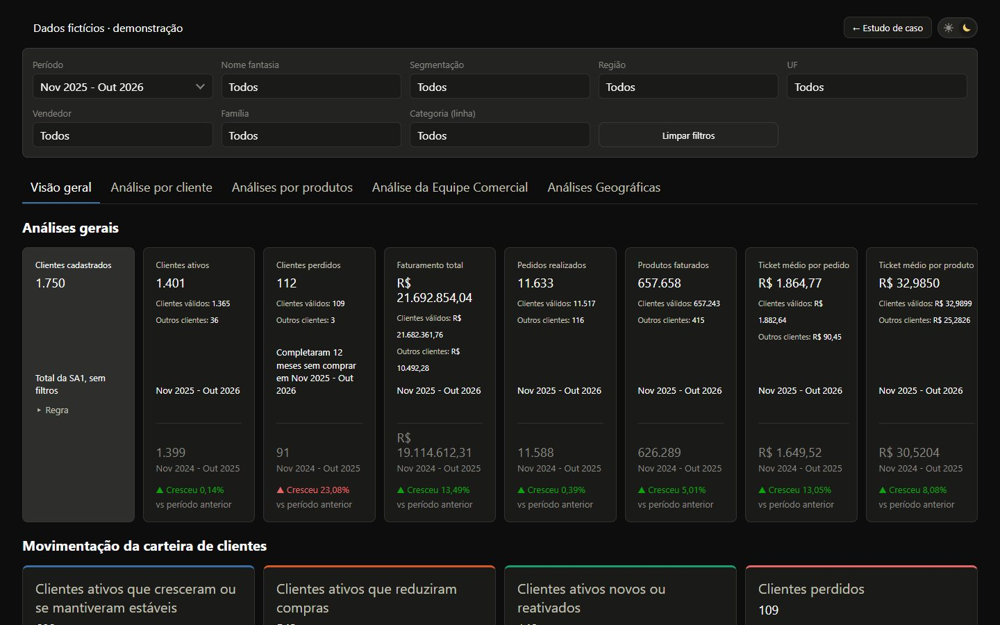

# Diagnóstico Comercial: do ERP ao painel 24/7

Estudo de caso de um painel de diagnóstico comercial (sell-in) construído do zero para uma indústria de cosméticos profissionais. O projeto cobre a descoberta das bases no ERP e no BI, a modelagem fato/dimensão, o banco na nuvem, o pipeline de carga, o painel interativo, a validação contra o faturamento oficial e a implantação rodando 24 horas.

**[Ler o estudo de caso](https://lariantunez.github.io/Diagnostico-Comercial/)** · **[Abrir o painel](https://lariantunez.github.io/Diagnostico-Comercial/painel/)**



> **Dados fictícios.** O projeto real está em produção. Esta versão de portfólio usa o mesmo código do painel, com uma empresa inventada (*Aurora Cosméticos Profissionais*) e uma base gerada por script. Nenhum nome, CNPJ, cliente, vendedor ou valor vem de dados reais.

## O que tem aqui

| Caminho | Conteúdo |
|---|---|
| `index.html` e `assets/` | Estudo de caso em 13 capítulos: desafio, princípios, mapeamento das bases, fluxograma, regras, modelo estrela, banco, backend, front-end, ajustes de layout, validação e implantação |
| `painel/` | O painel completo, com filtros, cliques que filtram a página, 5 abas, mapa, tabelas com busca e exportação CSV e tema claro/escuro. Roda 100% no navegador |
| `painel/dados/dados.js` | Pacote de dados fictícios, no mesmo formato binário (vetores em base64) que o pipeline real exporta do MongoDB |
| `ferramentas/gerar-dados-ficticios.js` | Gerador da base fictícia: 37 meses, sazonalidade, reajustes, ciclo de vida de clientes, redes, devoluções e demonstradoras. Semente fixa, então o resultado é sempre o mesmo |
| `ferramentas/atualizar-painel.js` | Copia o painel do projeto original e o adapta ao modo demonstração (sem servidor) |

## Arquitetura do projeto real

```
ERP (cadastros, agendas) ─┐
BI (faturamento, pedidos) ─┼─► tratamento (Node.js) ─► MongoDB Atlas (fatos + dimensões) ─► pacote binário ─► painel (JS puro + SVG)
Faturamento oficial ───────┘                                    ▲
                                       importação pelo navegador ┘   (Koyeb 24/7, link secreto, bases espelhadas no Atlas)
```

- **Modelo:** 2 fatos com grãos diferentes (faturamento por produto; pedidos por cliente), 1 evento de compra e 9 dimensões.
- **Carga:** 11 etapas automatizadas, carga rápida ou completa, histórico com "desfazer" e pico de memória medido por etapa.
- **Painel:** sem framework e sem biblioteca de gráficos. O motor de cálculo roda no navegador e recalcula todos os indicadores a cada filtro.
- **Validação:** faturamento, pedidos, segmentação, estados, categorias e produtos conferidos contra o relatório oficial nos 37 meses.
- **Implantação:** Koyeb (2 GB) e MongoDB Atlas. Código no GitHub, dados fora do repositório, acesso por link secreto.

## Rodar localmente

Qualquer servidor de arquivos estáticos serve. Por exemplo:

```bash
python -m http.server 8000
# abra http://localhost:8000
```

Para gerar a base fictícia de novo (Node.js 18 ou mais recente):

```bash
node ferramentas/gerar-dados-ficticios.js
```

---

**🇺🇸 English:** a case study of a sales diagnostics dashboard built from scratch for a professional cosmetics manufacturer. It covers discovering the ERP and BI sources, a star schema (2 fact tables at different grains, 9 dimensions), an 11-step load pipeline with undo, a framework-free dashboard whose calculation engine runs in the browser, validation against official revenue across 37 months, and 24/7 deployment on Koyeb with MongoDB Atlas. The portfolio version uses the same dashboard code with a fictional company and a seeded data generator.

---

Larissa Antunez · Analytics & Desenvolvimento
